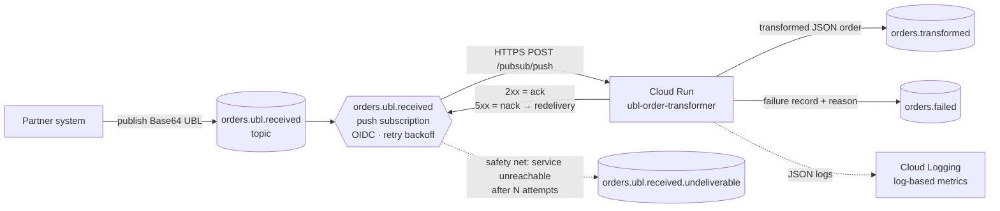
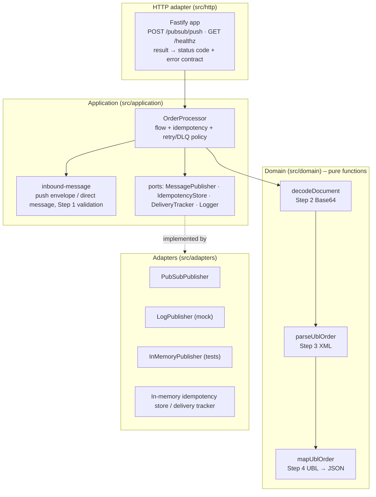
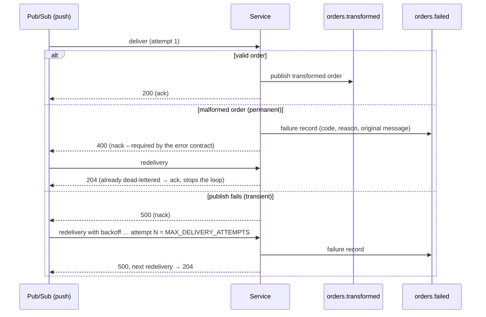

# UBL Order Transformer

[](https://github.com/tomaszb911/kramp_assesment/actions/workflows/ci.yml)

Event-driven service that receives **Base64-encoded UBL 2.1 Order XML** documents from a
Pub/Sub **push subscription**, transforms them into the target **JSON order** model and publishes
the result to an output topic. Built to run on **Cloud Run** (TypeScript / Node.js 22, Fastify),
with infrastructure as code in **Terraform**.

```
orders.ubl.received ──push──▶ Cloud Run: ubl-order-transformer ──▶ orders.transformed
                                           │
                                           └──(failed, with reason)──▶ orders.failed
```

**Highlights**

- Error contract implemented exactly as specified (`InvalidBase64`, `InvalidXml`, `ValidationError`, `ServerError`).
- All bonus requirements: **dead-letter queue**, **configurable retries**, **observability**
  (structured Cloud Logging logs correlated by `messageId`, processing-duration metric) and **idempotency**.
- Runs three ways: plain `docker run` (publisher mocked to logs), `docker compose` with the **Pub/Sub
  emulator** (real end-to-end flow), or on **GCP** via Terraform.
- 150+ unit and integration tests, including tests against the Pub/Sub emulator; CI on GitHub Actions.

---

## Contents

1. [Quick start](#quick-start)
2. [Architecture](#architecture)
3. [API & message formats](#api--message-formats)
4. [UBL → JSON mapping](#ubl--json-mapping)
5. [Delivery semantics: retries, DLQ, idempotency](#delivery-semantics-retries-dlq-idempotency)
6. [Observability](#observability)
7. [Local development & publishing test messages](#local-development--publishing-test-messages)
8. [Testing](#testing)
9. [Docker](#docker)
10. [Deployment to GCP (Terraform)](#deployment-to-gcp-terraform)
11. [Configuration](#configuration)
12. [Design decisions & trade-offs](#design-decisions--trade-offs)
13. [Assumptions](#assumptions)
14. [What I would add for production](#what-i-would-add-for-production)

---

## Quick start

**Option A – just the container (no GCP, publisher mocked to logs):**

```bash
docker build -t ubl-order-transformer .
docker run --rm -p 8080:8080 -e PUBLISHER=log ubl-order-transformer

# in another terminal
curl -s -X POST http://localhost:8080/pubsub/push \
  -H 'content-type: application/json' \
  -d @samples/messages/valid-order.json
```

**Option B – full event-driven flow with the Pub/Sub emulator** (requires Node.js 22 for the helper scripts):

```bash
npm ci
docker compose up --build -d --wait               # emulator + topics/push subscription + service
npm run pubsub:publish -- samples/messages/valid-order.json samples/messages/invalid-xml.json
npm run pubsub:pull                               # shows orders.transformed and orders.failed
docker compose logs app                           # structured logs of the service
docker compose down
```

**Option C – Node.js directly:**

```bash
npm ci
PUBLISHER=log LOG_PRETTY=true npm run dev
```

---

## Architecture

### Runtime view (GCP)



### Code structure (ports & adapters)



- **Domain** – pure, synchronous functions with no I/O: trivially unit-testable.
- **Application** – `OrderProcessor` orchestrates the processing flow and owns the delivery policies.
  It is transport-agnostic: it receives the request body and returns a `ProcessingResult`.
- **Adapters** – infrastructure behind small interfaces, so Pub/Sub can be swapped for the in-memory
  publisher in tests or for the log publisher locally, and the in-memory stores for Firestore/Redis later.
- **HTTP** – translates `ProcessingResult` into the status codes Pub/Sub push understands.
- **Composition root** – `src/server.ts` wires everything from environment configuration.

### Processing flow

| Step                                                                              | Where                | Failure → response                       |
| --------------------------------------------------------------------------------- | -------------------- | ---------------------------------------- |
| 0. Unwrap push envelope (`message.data`) or accept the message posted directly    | `inbound-message.ts` | `400 ValidationError`                    |
| 1. Validate message: message, `messageId`, `document` exist, `document` not empty | `inbound-message.ts` | `400 ValidationError`                    |
| 2. Decode Base64 (strict) → UTF-8 XML                                             | `decode-document.ts` | `400 InvalidBase64` / `400 InvalidXml`   |
| 3. Parse XML (well-formedness, no DTD, root `Order` not in a foreign namespace)   | `parse-ubl-order.ts` | `400 InvalidXml` / `400 ValidationError` |
| 4. Map UBL → JSON, validate required fields                                       | `map-ubl-order.ts`   | `400 ValidationError`                    |
| 5. Publish to `orders.transformed`                                                | `order-processor.ts` | `500 ServerError` (retried)              |

---

## API & message formats

### `POST /pubsub/push`

Accepts **either** of these bodies:

1. **Pub/Sub push envelope** – what Cloud Run receives from the push subscription. The business
   message is the Base64-encoded JSON in `message.data`
   ([example](samples/messages/pubsub-push-envelope.json)):

   ```json
   {
     "message": {
       "data": "eyJtZXNzYWdlSWQiOiI3YTFlNzhjOSIsInRpbWVzdGFtcCI6IjIwMjYtMDctMjdUMTI6MDA6MDBaIiwiZG9jdW1lbnQiOiJQRDk0Li4uIn0=",
       "messageId": "15386731280394612",
       "publishTime": "2026-07-27T12:00:00Z",
       "attributes": {}
     },
     "subscription": "projects/<project>/subscriptions/orders.ubl.received"
   }
   ```

2. **The business message itself** – handy for local testing and manual replays
   ([example](samples/messages/valid-order.json)):

   ```json
   {
     "messageId": "7a1e78c9",
     "timestamp": "2026-07-27T12:00:00Z",
     "document": "PD94bWwgdmVyc2lvbj0iMS4wIiBlbmNvZGluZz0iVVRGLTgiIHN0YW5kYWxvbmU9InllcyI/Pgo8T3JkZXIg..."
   }
   ```

### Responses

| Status                      | When                                                                               | Body                                                                                                                  |
| --------------------------- | ---------------------------------------------------------------------------------- | --------------------------------------------------------------------------------------------------------------------- |
| `200 OK`                    | Order transformed and published (or a duplicate – see [idempotency](#idempotency)) | the transformed order; header `x-idempotent-replay: true\|false`, `x-document-mismatch: true` on a reused `messageId` |
| `204 No Content`            | Pub/Sub **redelivery** of a message that was already moved to the DLQ              | –                                                                                                                     |
| `400 Bad Request`           | Invalid Base64 / XML / missing fields                                              | error contract                                                                                                        |
| `413 Payload Too Large`     | Body above `BODY_LIMIT_BYTES`                                                      | error contract                                                                                                        |
| `500 Internal Server Error` | Unexpected / transient error (e.g. publishing failed)                              | error contract                                                                                                        |

**Output message** (published to `orders.transformed` and returned in the response;
[example](samples/output/transformed-order.json)). Pub/Sub attributes: `messageId`, `orderId`.

```json
{
  "messageId": "7a1e78c9",
  "transformedAt": "2026-07-27T12:01:00Z",
  "order": {
    "orderId": "12347",
    "externalOrganizationId": "1234567",
    "reference": "test-order",
    "orderDate": "2025-01-01",
    "lines": [
      {
        "lineId": 1,
        "itemId": "100100",
        "quantity": 1,
        "unitOfMeasure": "EA",
        "comment": "Optional OrderLine Note"
      },
      {
        "lineId": 2,
        "itemId": "100103",
        "quantity": 1,
        "unitOfMeasure": "EA",
        "comment": "Optional OrderLine Note"
      }
    ]
  }
}
```

**Error contract** (exactly as specified; `messageId` is `null` when it could not be determined):

```json
{ "error": "InvalidBase64",   "message": "Document is not a valid Base64 string.",        "messageId": "7a1e78c9" }
{ "error": "InvalidXml",      "message": "Message could not be parsed from XML to JSON.", "messageId": "7a1e78c9" }
{ "error": "ValidationError", "message": "Order ID is required.",                          "messageId": "7a1e78c9" }
{ "error": "ServerError",     "message": "An unexpected error occurred.",                  "messageId": "7a1e78c9" }
```

Internal details (parser errors, publish failures) are never returned to the caller; they are logged
and stored in the dead-letter record.

### `GET /healthz`

`200 {"status":"ok"}` – used by the Cloud Run startup/liveness probes.

---

## UBL → JSON mapping

| UBL XPath                                              | JSON field               | Rules                                                                                |
| ------------------------------------------------------ | ------------------------ | ------------------------------------------------------------------------------------ |
| `Order/ID`                                             | `orderId`                | required, string (leading zeros preserved)                                           |
| `Order/IssueDate`                                      | `orderDate`              | required, valid `YYYY-MM-DD` (an `xsd:date` timezone suffix is accepted and dropped) |
| `Order/BuyerCustomerParty/SupplierAssignedAccountID`   | `externalOrganizationId` | required, string                                                                     |
| `Order/CustomerReference`                              | `reference`              | optional – omitted when absent                                                       |
| `OrderLine`                                            | `lines[]`                | at least one; a single line is still an array                                        |
| `OrderLine/Note`                                       | `lines[].comment`        | optional – omitted when absent; several notes are joined with `\n`                   |
| `OrderLine/LineItem/ID`                                | `lines[].lineId`         | required, positive integer, unique within the order                                  |
| `OrderLine/LineItem/Item/SellersItemIdentification/ID` | `lines[].itemId`         | required, string                                                                     |
| `OrderLine/LineItem/Quantity`                          | `lines[].quantity`       | required, positive decimal number                                                    |
| `OrderLine/LineItem/Quantity/@unitCode`                | `lines[].unitOfMeasure`  | required                                                                             |

- Matching uses **local names**, so it does not depend on the namespace prefixes a partner chooses
  (`cbc:`, `cac:`, `ubl:`…).
- The root element must be `Order`. Its namespace is checked against the UBL Order namespace
  `urn:oasis:names:specification:ubl:schema:xsd:Order-2` (as default namespace or bound to any prefix):
  an `Order` in a **foreign** namespace is another format and is rejected with `ValidationError`;
  an `Order` **without** a namespace is processed, and a warning is logged with the `messageId`.
  Strictly by the UBL standard such a document is not UBL, but rejecting otherwise correct XML would
  only slow down partner onboarding – the warning makes the problem visible without blocking orders.
- **All** validation problems are reported in one message, so a partner fixing an integration sees
  everything at once, e.g.
  `"OrderLine 2: quantity (LineItem/Quantity) is required. OrderLine 2: unit of measure (LineItem/Quantity/@unitCode) is required."`
  The message for a missing order ID is exactly the one from the specification: `"Order ID is required."`.
- Documents with a `DOCTYPE` are rejected (UBL does not use DTDs; this rules out entity-expansion / XXE attacks).

---

## Delivery semantics: retries, DLQ, idempotency

Pub/Sub push treats **2xx as acknowledgement** and anything else as a **nack**, which triggers a
redelivery with exponential backoff (configured on the subscription). Errors are therefore split into:

| Error kind    | Examples                                         | Retry?                                | Behaviour                                                                                            |
| ------------- | ------------------------------------------------ | ------------------------------------- | ---------------------------------------------------------------------------------------------------- |
| **Permanent** | `InvalidBase64`, `InvalidXml`, `ValidationError` | no – the same input can never succeed | dead-lettered to `orders.failed` **immediately**, response `400`                                     |
| **Transient** | `ServerError` (publish failed, unexpected error) | yes                                   | response `500` → Pub/Sub redelivers; on attempt `MAX_DELIVERY_ATTEMPTS` the message is dead-lettered |



### Dead-letter queue (`orders.failed`)

Each record contains everything needed to investigate and replay the message
(attributes: `errorCode`, `messageId`):

```json
{
  "messageId": "c0ffee02",
  "failedAt": "2026-10-22T17:08:36Z",
  "error": {
    "code": "InvalidXml",
    "message": "Message could not be parsed from XML to JSON.",
    "detail": "Unclosed tag 'Order'. (line 1, column 1)"
  },
  "deliveryAttempt": 1,
  "source": "pubsub-push",
  "pubsubMessageId": "2",
  "subscription": "projects/local-project/subscriptions/orders.ubl.received",
  "originalMessage": {
    "messageId": "c0ffee02",
    "timestamp": "2026-07-27T12:00:00Z",
    "document": "PE9yZGVyPjxjYmM6SUQ+MTIzNDc8L2NiYzpJRD4="
  }
}
```

If dead-lettering itself fails, the service answers `500`, so Pub/Sub keeps the message – nothing is lost.

**Safety net:** the Terraform subscription additionally has a native Pub/Sub dead-letter policy
(`undeliverable_max_delivery_attempts`, default 10 > `MAX_DELIVERY_ATTEMPTS`) forwarding to
`orders.ubl.received.undeliverable`. It only kicks in when the service cannot answer at all
(crash loop, outage). As a side effect it makes Pub/Sub send `deliveryAttempt`, which the service
prefers over its own attempt counter.

### Retries

- `MAX_DELIVERY_ATTEMPTS` (service, default 5) – attempts before a transient failure is dead-lettered.
- `retry_minimum_backoff` / `retry_maximum_backoff` (Terraform, default 10 s / 300 s) – redelivery backoff.

### Idempotency

Pub/Sub delivers **at least once**, and a partner may publish the same order twice. The service
remembers successfully transformed messages by business `messageId` (TTL `IDEMPOTENCY_TTL_SECONDS`):

- a duplicate is **not published again**; the earlier output is returned (`x-idempotent-replay: true`);
- concurrent duplicates on the same instance share one in-flight transformation;
- failures are not remembered, so a corrected message with the same `messageId` can be processed;
- a **`messageId` reused for a different document** (most likely a partner bug: two orders, one id) is
  detected by a SHA-256 fingerprint of the document stored with the result. Policy: **warn, don't
  reject** – the earlier result is still replayed and nothing is published, but the summary log line
  is a `WARNING` with `documentMismatch: true` and direct callers get `x-document-mismatch: true`.
  Rejecting would also be defensible; warning keeps the idempotency contract simple
  (same `messageId` → same answer) while making the partner problem visible.
  Line breaks in the Base64 are ignored by the fingerprint, so re-wrapped encodings are not flagged.

> **Limitation (deliberate for this assignment):** the stores are in-memory, i.e. per Cloud Run
> instance. They sit behind the `IdempotencyStore` / `DeliveryTracker` interfaces; with several
> instances they should be backed by a shared store (Firestore with a create-if-absent transaction,
> or Memorystore/Redis `SET NX`). Downstream consumers can also deduplicate on the `messageId` attribute.

---

## Observability

Logs are JSON lines in the [Cloud Logging structured format](https://cloud.google.com/logging/docs/structured-logging)
(`severity`, `message`, `time`), so on Cloud Run every field is queryable. Exactly **one summary line
per processed message** is written, carrying the correlation id and the processing duration:

```json
{"severity":"INFO","time":"2026-10-22T17:11:26.088Z","service":"ubl-order-transformer","messageId":"93577cfe-2dab-48d2-81ba-b08d267239bd","source":"pubsub-push","pubsubMessageId":"3","outcome":"transformed","durationMs":141.82,"replayed":false,"orderId":"12348","lineCount":1,"message":"Order transformed"}
{"severity":"WARNING","time":"2026-10-22T17:11:26.090Z","service":"ubl-order-transformer","messageId":"c0ffee03","source":"pubsub-push","pubsubMessageId":"2","outcome":"rejected","durationMs":149.75,"errorCode":"ValidationError","errorMessage":"Order ID is required.","attempt":1,"deadLettered":true,"message":"Message rejected"}
```

- **Correlation:** every line of a message carries `messageId` (and `pubsubMessageId`), so
  `jsonPayload.messageId="7a1e78c9"` shows its full history across retries and instances.
- **Severity:** `INFO` success, `WARNING` rejected input (partner problem), `ERROR` transient/server
  failures (our problem) – alerting can target `ERROR` only.
- **Metrics** (Terraform, log-based): `processing_duration` (distribution of `durationMs` by `outcome`)
  and `processed_messages` (count by `outcome` and `error_code`), ready for dashboards and alerts.

Locally `LOG_PRETTY=true` switches to human-readable output.

---

## Local development & publishing test messages

Prerequisites: Node.js 22 (`.nvmrc`), Docker.

| Command                                                 | Description                                                                                   |
| ------------------------------------------------------- | --------------------------------------------------------------------------------------------- |
| `npm run dev`                                           | Start with hot reload (`PUBLISHER=log LOG_PRETTY=true npm run dev` without Pub/Sub)           |
| `npm test`                                              | Unit + integration tests (emulator tests are skipped unless `PUBSUB_EMULATOR_HOST` is set)    |
| `npm run test:coverage`                                 | Tests with coverage report                                                                    |
| `npm run lint` / `npm run typecheck` / `npm run format` | Static checks                                                                                 |
| `npm run build` / `npm start`                           | Compile to `dist/` and run                                                                    |
| `npm run pubsub:setup`                                  | Create topics + push subscription in the emulator (done automatically by `docker compose up`) |
| `npm run pubsub:publish -- <file...>`                   | Publish `.json` messages or raw `.xml` orders to `orders.ubl.received`                        |
| `npm run pubsub:pull`                                   | Print and ack what was published to `orders.transformed` / `orders.failed`                    |
| `npm run make:message -- <order.xml> [messageId]`       | Wrap a UBL XML file into a message (Base64)                                                   |
| `npm run samples:generate`                              | Regenerate `samples/messages` from `samples/ubl`                                              |

The helper scripts target the **local emulator** (`localhost:8085`) unless `GOOGLE_CLOUD_PROJECT`
is set, so they cannot publish to a real project by accident.

### Three ways to send a test message

1. **Through Pub/Sub (emulator)** – the real event-driven path:
   ```bash
   docker compose up --build -d --wait
   npm run pubsub:publish -- samples/messages/valid-order.json
   npm run pubsub:publish -- samples/ubl/order-single-line.xml   # raw XML gets a generated messageId
   npm run pubsub:pull
   ```
2. **Directly over HTTP** – `curl` with any file from `samples/messages`, or open
   [`requests.http`](requests.http) in VS Code (REST Client) / IntelliJ:
   ```bash
   curl -i -X POST http://localhost:8080/pubsub/push -H 'content-type: application/json' \
     -d @samples/messages/missing-order-id.json
   ```
3. **Own XML** – `npm run make:message -- my-order.xml my-id-1 > my-message.json` and send it either way.

### Sample messages

| File                                                                            | Expected result                                                   |
| ------------------------------------------------------------------------------- | ----------------------------------------------------------------- |
| [`valid-order.json`](samples/messages/valid-order.json)                         | `200`, [transformed order](samples/output/transformed-order.json) |
| [`pubsub-push-envelope.json`](samples/messages/pubsub-push-envelope.json)       | `200`, same order (push envelope format)                          |
| [`valid-order-single-line.json`](samples/messages/valid-order-single-line.json) | `200`, one line, `LTR` unit                                       |
| [`invalid-base64.json`](samples/messages/invalid-base64.json)                   | `400 InvalidBase64`                                               |
| [`invalid-xml.json`](samples/messages/invalid-xml.json)                         | `400 InvalidXml`                                                  |
| [`missing-order-id.json`](samples/messages/missing-order-id.json)               | `400 ValidationError` – `Order ID is required.`                   |
| [`missing-document.json`](samples/messages/missing-document.json)               | `400 ValidationError` – `document is required.`                   |

The readable XML sources are in [`samples/ubl`](samples/ubl). A test (`test/integration/samples.test.ts`)
keeps this table true.

---

## Testing

```bash
npm test                                                   # 167 tests, no external dependencies
docker compose up -d --wait pubsub-emulator
PUBSUB_EMULATOR_HOST=localhost:8085 npm run test:coverage  # + tests against the Pub/Sub emulator
```

| Suite                                                        | What it covers                                                                                                                   |
| ------------------------------------------------------------ | -------------------------------------------------------------------------------------------------------------------------------- |
| `test/unit/decode-document`                                  | Base64 decoding: strict alphabet/padding, MIME line breaks, BOM, non-UTF-8                                                       |
| `test/unit/parse-ubl-order`                                  | XML parsing: prefixes, UBL root namespace, single line as array, entities, malformed XML, DTD rejection, non-Order root          |
| `test/unit/map-ubl-order`                                    | UBL mapping: expected output, optional fields, types, every validation rule                                                      |
| `test/unit/inbound-message`                                  | Message validation and push-envelope unwrapping                                                                                  |
| `test/unit/order-processor`                                  | Flow + policies: idempotency (incl. concurrency), permanent vs transient errors, retries, DLQ                                    |
| `test/unit/logger`, `config`, `in-memory-stores`, `shutdown` | Cloud Logging format, configuration validation, TTL stores, shutdown timeout (fake timers)                                       |
| `test/integration/push-endpoint`                             | Full HTTP stack: consume valid/malformed messages, publish transformed order, error contract, DLQ, retries, 204 acks, size limit |
| `test/integration/samples`                                   | Every file in `samples/` produces the documented result                                                                          |
| `test/integration/pubsub-emulator`                           | Real `PubSubPublisher` against the emulator: output topic and DLQ                                                                |

Integration tests use Fastify's `inject` (no open ports) with the real processor and in-memory
adapters; only the broker is replaced. Coverage is ~96 % of statements.

---

## Docker

```bash
docker build -t ubl-order-transformer .

# publisher mocked to logs – no GCP needed
docker run --rm -p 8080:8080 -e PUBLISHER=log ubl-order-transformer

# against a Pub/Sub emulator running on the host
docker run --rm -p 8080:8080 --add-host=host.docker.internal:host-gateway \
  -e PUBSUB_EMULATOR_HOST=host.docker.internal:8085 -e GOOGLE_CLOUD_PROJECT=local-project \
  -e METADATA_SERVER_DETECTION=none ubl-order-transformer
```

Multi-stage build (TypeScript compiled in the build stage, only production dependencies in the
runtime stage), runs as the non-root `node` user, handles `SIGTERM` gracefully (Cloud Run sends it
before stopping an instance; in-flight requests finish, the Pub/Sub client is flushed and closed).
Cloud Run kills the instance ~10 s after `SIGTERM`, so if closing hangs (e.g. Pub/Sub unreachable)
the service exits on its own after `SHUTDOWN_TIMEOUT_MS` (9 s) with a log line saying why.

`docker compose up --build -d --wait` starts the complete local environment: Pub/Sub emulator, a
one-off job creating the topics, the push subscription `orders.ubl.received → http://app:8080/pubsub/push`
and debug pull subscriptions, and then the service (`PUBLISHER=pubsub`). `--wait` returns once
everything is ready. Ports: `8085` (emulator) and `8080` (service; change with `APP_PORT=8081 docker compose up …`
if 8080 is taken).

---

## Deployment to GCP (Terraform)

[`infra/terraform`](infra/terraform) provisions:

- topics `orders.ubl.received`, `orders.transformed`, `orders.failed`, `orders.ubl.received.undeliverable`;
- **push subscription** `orders.ubl.received` → Cloud Run with **OIDC authentication**, exponential
  retry backoff and the native dead-letter safety net;
- **Cloud Run v2** service (internal ingress only – reachable by Pub/Sub, not from the internet),
  startup/liveness probes on `/healthz`;
- **least-privilege service accounts**: the runtime identity may only publish to its two output
  topics; the push identity may only invoke the service;
- Artifact Registry repository, inspection subscriptions for the DLQ topics, **log-based metrics**.

```bash
cd infra/terraform
cp terraform.tfvars.example terraform.tfvars      # set project_id and image
terraform init
terraform apply -target=google_artifact_registry_repository.services   # first run only

# build & push the image
REPO=$(terraform output -raw image_repository)
gcloud auth configure-docker europe-west4-docker.pkg.dev
docker build -t "$REPO:1.0.0" ../.. && docker push "$REPO:1.0.0"

terraform apply                                   # with image = "$REPO:1.0.0"
```

Then publish a test message to the real topic:

```bash
GOOGLE_CLOUD_PROJECT=<project> npm run pubsub:publish -- samples/messages/valid-order.json
```

> The configuration passes `terraform validate` (also in CI). In a team setup state would live in a
> GCS backend (commented out in `versions.tf`) and `apply` would run from CI with Workload Identity Federation.

---

## Configuration

| Variable                  | Default              | Description                                                                        |
| ------------------------- | -------------------- | ---------------------------------------------------------------------------------- |
| `PORT`                    | `8080`               | HTTP port (set by Cloud Run)                                                       |
| `PUBLISHER`               | `pubsub`             | `pubsub` – Google Cloud Pub/Sub (or emulator); `log` – mocked, messages are logged |
| `OUTPUT_TOPIC`            | `orders.transformed` | Topic for transformed orders                                                       |
| `DEAD_LETTER_TOPIC`       | `orders.failed`      | Topic for failed messages                                                          |
| `MAX_DELIVERY_ATTEMPTS`   | `5`                  | Attempts before a transient failure is dead-lettered                               |
| `IDEMPOTENCY_TTL_SECONDS` | `86400`              | How long processed `messageId`s are remembered                                     |
| `BODY_LIMIT_BYTES`        | `15728640`           | Max request size (Pub/Sub messages ≤ 10 MB + Base64 envelope overhead)             |
| `SHUTDOWN_TIMEOUT_MS`     | `9000`               | Force exit if graceful shutdown takes longer (Cloud Run kills ~10 s after SIGTERM) |
| `LOG_LEVEL`               | `info`               | `trace` … `fatal`, `silent`                                                        |
| `LOG_PRETTY`              | `false`              | Human-readable logs for local development                                          |
| `GOOGLE_CLOUD_PROJECT`    | –                    | GCP project (auto-detected on Cloud Run)                                           |
| `PUBSUB_EMULATOR_HOST`    | –                    | Use the Pub/Sub emulator, e.g. `localhost:8085`                                    |

Invalid values stop the service at startup with a list of all problems (fail fast).

---

## Design decisions & trade-offs

**Push subscription + Cloud Run (not a pull subscriber).** The assignment asks for Cloud Run and a
push subscription: Cloud Run scales on HTTP requests (including to zero), and pull subscribers need
always-on CPU. The service is still transport-agnostic – a pull subscriber would be another thin
adapter calling `OrderProcessor.process`.

**`400` for invalid messages vs. Pub/Sub semantics.** The required `400` is a _nack_ for Pub/Sub, so
an invalid message would be redelivered forever. I kept the specified contract and broke the loop
on the service side: permanent errors are dead-lettered at once, and a redelivery of an
already dead-lettered Pub/Sub message is acknowledged with `204`. Direct callers always get the
specified `400`. The alternative – answering `2xx` to Pub/Sub for invalid messages after
dead-lettering – is simpler but would break the specified API.

**Service-level DLQ instead of only Pub/Sub's native dead-lettering.** Native dead-lettering forwards the
raw message without saying _why_ it failed, and it retries permanent errors pointlessly. The service
knows the reason, so it publishes an enriched record (error code, detail, attempt, original message)
and dead-letters permanent errors immediately. The native policy is kept as a safety net for
outages only.

**Idempotency on the business `messageId`, retries on Pub/Sub's message id.** A partner re-publishing the
same order creates a new Pub/Sub message with the same business `messageId` → must not produce a second
output. A redelivery keeps Pub/Sub's message id → used to count attempts and recognise already
dead-lettered deliveries. Only successes are remembered, so a corrected re-send is not blocked by an
earlier failure.

**Collect all validation errors.** The role is about smooth partner onboarding; one round-trip
listing every missing field beats fixing them one by one. The single-field message stays
exactly as specified (`Order ID is required.`).

**`fast-xml-parser`** – pure JS (no native build in the container), fast, removes namespace prefixes,
does not resolve external entities. Combined with explicit `XMLValidator` well-formedness checks and DTD rejection.
Because removing prefixes also drops the `xmlns` declarations, the root element's namespace is resolved by a
second, namespace-preserving parse – negligible cost for order-sized documents, and simpler than mapping
prefixed names by hand.

**Fastify** – small, fast, first-class TypeScript and pino logging (the same logger Cloud Logging
formatting is built on).

**No schema/DI frameworks.** Validation is ~50 lines of explicit code producing partner-friendly
messages; dependencies are wired by hand in `server.ts`. Fewer moving parts for a single-purpose service.

---

## Assumptions

- The Pub/Sub message `data` is the JSON business message from the specification
  (`messageId`, `timestamp`, `document`). The business `messageId` is used for correlation and
  idempotency; Pub/Sub's own message id is logged as `pubsubMessageId`.
- `timestamp` is optional and not validated – it is not part of the output.
- `reference` (`CustomerReference`) and `comment` (`OrderLine/Note`) are optional in UBL, so they are
  omitted from the output when absent (rather than `null`).
- `lineId` and `quantity` are numbers, as in the example output; `orderId`, `itemId` and
  `externalOrganizationId` stay strings to preserve leading zeros.
- `transformedAt` uses second precision (`2026-07-27T12:01:00Z`), like the example.
- The example output in the specification misses a comma after `"orderDate": "2025-01-01"`; the
  service produces valid JSON with the same structure.
- The input subscription is called `orders.ubl.received`, like the topic (the specification uses the
  name for the subscription; Pub/Sub topic and subscription names live in separate namespaces).

---

## What I would add for production

- **Shared idempotency/delivery store** (Firestore or Memorystore) behind the existing interfaces.
- **XSD validation** against the official UBL 2.1 schemas (today: well-formedness, root element and namespace, required fields).
- **Pub/Sub schema** (Avro/Protobuf) on `orders.transformed` as the contract for downstream consumers.
- **Alerting**: on DLQ growth, `ERROR` log rate and p95 `processing_duration`; a small **replay tool**
  that re-publishes records from `orders.failed` after a fix.
- **OpenTelemetry tracing** propagated via Pub/Sub attributes, end to end across services.
- **CD pipeline**: build → push to Artifact Registry → `terraform apply` from GitHub Actions with
  Workload Identity Federation, per-environment workspaces/state.
- **Multiple document formats** (cXML, other UBL versions) as additional transformers selected by
  message attributes, reusing the same delivery policies.

---

## Project structure

```
src/
  domain/           pure transformation: errors, decode-document, parse-ubl-order, map-ubl-order, order model
  application/      OrderProcessor (flow, idempotency, retry/DLQ policy), inbound-message, ports
  adapters/         PubSubPublisher, LogPublisher, InMemoryPublisher, in-memory stores, TTL cache
  http/             Fastify app (push endpoint, health check, error contract)
  config.ts         environment configuration (fail fast)
  logger.ts         Cloud Logging structured logger
  shutdown.ts       SIGTERM/SIGINT handling with a shutdown timeout
  server.ts         composition root
scripts/            pubsub:setup / publish / pull, make:message, samples:generate
samples/            ubl/*.xml, messages/*.json, output/*.json
test/               unit/, integration/, fixtures/
infra/terraform/    Pub/Sub, Cloud Run, IAM, Artifact Registry, log-based metrics
.github/workflows/  CI: lint, typecheck, tests (+ emulator), Docker build & smoke test, Terraform validate
```
